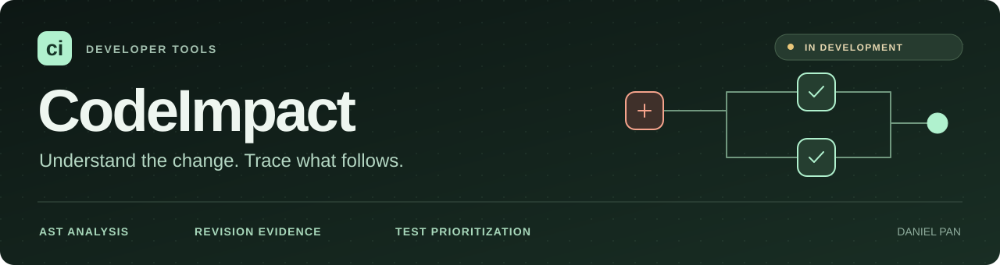
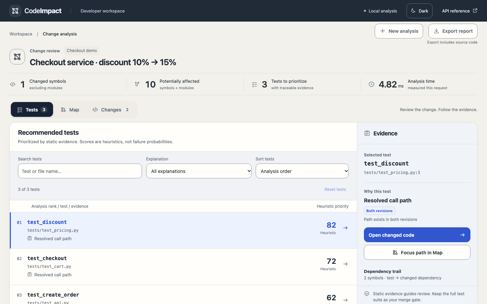

# CodeImpact

**Explainable change-impact analysis for Python.**

CodeImpact turns a code change into an inspectable dependency graph and a prioritized list of tests. Every recommendation includes a path back to a changed symbol, with source locations and evidence from the analyzed revisions.

**Status: actively in development.** The local application supports public GitHub PRs, uploaded snapshots, and committed local Git history. A built pilot server with access controls and bounded analysis workers is verified locally; live hosting is deferred. Private-repository integration is not implemented.

[Quick start](#quick-start) · [Usage guide](docs/USAGE.md) · [Architecture](docs/ARCHITECTURE.md) · [Validation](docs/VALIDATION.md) · [CI](https://github.com/danielpan01/CodeImpact/actions/workflows/ci.yml)

## See the impact



*The refined workspace opens in Tests, with rounded shared controls, a distinct evidence surface and a saved light/dark preference. [Entry screen](docs/media/milestone8a/after-desktop-light-entry.png) · [Dark theme](docs/media/milestone8a/after-desktop-dark-tests.png) · [Focused map](docs/media/milestone8a/after-desktop-dark-map.png) · [Before/after and verification](docs/FRONTEND_MILESTONE8A.md). Milestone 8A merged in [PR #13](https://github.com/danielpan01/CodeImpact/pull/13). Milestone 8B adds searchable analysis diagnostics; see [grouping, counts and verification](docs/FRONTEND_MILESTONE8B.md).*

A change to `discount(total)` can affect an unchanged API test through `test_create_order → create_order → checkout → discount`. CodeImpact makes that relationship visible, then lets you inspect each dependency and the changed code.

## What works today

| Capability | What it provides |
| :--- | :--- |
| **Semantic change detection** | Compares Python ASTs, ignoring comments, whitespace, and source-line movement. |
| **Dependency analysis** | Indexes symbols and supported calls/imports; preserves removed dependencies across revisions. |
| **Function-local imports** | Resolves direct local import aliases after their binding statement; keeps ambiguous bindings unresolved and import fallback scoped to the function. |
| **Module import rebinding** | Suppresses misleading resolved calls when a module import name has competing bindings; preserves conservative import evidence. |
| **Scoped fallback selection** | Separates body edits from initialization changes; uses bounded possible references to avoid unrelated class/module recommendations without inventing resolved calls. |
| **Module-level partial calls** | Resolves bounded `functools.partial` bindings to unambiguous functions, with alias, re-export and lexical-scope guards. |
| **Argument-sensitive call paths** | Filters existing resolved paths when bounded argument guards establish a bypass or early exit; preserves other fallback evidence. |
| **Constructor and factory arguments** | Tracks bounded default overrides, partial factories, forwarded options and early exits; uncertain cases retain recommendations. |
| **Bounded test discovery** | Recognizes `test_` definitions in `test.py`, `test_*.py` and `*_test.py`, with explicit static-discovery limits. |
| **Explainable test priorities** | Uses cycle-safe reverse traversal and deterministic heuristic scores, with a typed evidence path for each recommendation. |
| **Revision-aware code review** | Shows before/after source and labels dependencies as before-only, after-only, or shared; mixed-revision paths are explicit. |
| **Three input workflows** | Public GitHub PR URLs, JSON snapshot pairs, and a CLI for committed local Git history. |
| **Review workspace** | Light/dark themes, compact report context, searchable/filterable Tests with deterministic sorting, focused evidence paths in Map, syntax-colored before/after Changes, and a coordinated evidence inspector; dedicated evidence navigation on phones and tablets. |
| **Inspectable reports** | Exportable JSON, source-export disclosure, exact analyzed GitHub revisions, and expandable before/after/mixed evidence. |
| **Readable analysis notes** | Lossless category/file grouping, literal full-text search, filters and explicit paging; every original warning occurrence remains in exports. |
| **Authored correctness corpus** | Evaluates 25 complete snapshot cases against explicit dependency labels, records known mistakes, and validates typed paths and revision evidence. |
| **Real-source evaluation pilot** | Replays six pinned changes across three public repositories offline, with complete supported Python trees, verified provenance, draft-label review packs and explicit mistakes. |
| **Fresh-source regression gates** | Replays v2 and v3 pinned changes with preserved first measurements, explicit regression baselines and a test-discovery audit, checking source, label, evidence and result drift in CI. |
| **Local pilot service** | Serves the built dashboard and API together, protects user-submitted analyses with an in-memory access-key flow, and bounds disposable workers, request sizes, deadlines and admission. |

**Stack:** Python · FastAPI · Python AST · React · TypeScript · React Flow · Vite · pytest · Playwright

## Engineering decisions

- **Analyze source as data.** GitHub ingestion pins the merge base and PR head, verifies downloaded blobs, and bounds network requests and source size. It does not execute, import, or install the analyzed repository.
- **Keep deleted code in the analysis.** The dependency graph combines both revisions so removed functions can still explain potential impact.
- **Make uncertainty visible.** Resolved calls are distinguished from conservative module/import estimates. A path assembled across revisions is labeled accordingly.
- **Make results inspectable.** Recommendations retain exact edge IDs, source locations, and revision-specific evidence. Report schema 2.0 includes complete changed-file source.

The [architecture guide](docs/ARCHITECTURE.md) documents the graph model, scoring formula, report contract, and ingestion limits.

## Quick start

Prerequisites: **Python 3.12+**, **Node.js 24**, npm, Git, and Make. Ensure `python3` selects the required Python version.

```sh
git clone https://github.com/danielpan01/CodeImpact.git
cd CodeImpact
make setup
make dev
```

Open **http://127.0.0.1:5173**. API documentation is at **http://127.0.0.1:8000/docs**. Stop both services with Ctrl-C.

### A one-minute walkthrough

1. Choose **Load demo** on the input screen; it analyzes a discount change from 10% to 15% and opens **Tests**.
2. Select `test_create_order` and follow its dependency path. On phones/tablets, use **Back to results** to return from evidence.
3. Choose **Focus path in Map**, jump to a dependency, or use **Fit view** to see the entire path.
4. Choose **Open changed code** to inspect the before/after implementation. Search or filter **Tests**, then export the complete report. **New analysis** reopens PR input, snapshot upload, and the demo.
5. Use the sun/moon control in the header to switch themes. The initial theme follows your device; a chosen preference is saved locally when browser storage is available. Theme changes preserve your selection and report.

You can also paste a public GitHub PR URL or upload snapshot pairs. See the [usage guide](docs/USAGE.md) for CLI examples, a deleted-function fixture, API requests, configuration, and troubleshooting.

For the built application, follow the [local deployment guide](docs/DEPLOYMENT.md):
set a pilot access key and run `make serve`. It serves one origin on port 8080 and
keeps the fixture demo public. Live hosting remains deferred. The
[performance receipt](docs/PERFORMANCE.md) records ten fresh-worker measurements
per fixed case; it does not claim production capacity.

## Evaluate the analyzer

The [authored correctness corpus](docs/CORPUS.md) contains 25 small, complete
base/head examples with explicit affected, unaffected and unclassified test labels.
Run it from the repository root with the pinned environment:

```sh
make evaluate
# Full results, labels, snapshots and typed paths: reports/corpus-evaluation.json
.venv/bin/python -m codeimpact.evaluate --case local_import \
  --output reports/local-import.json
```

Observed agreement with these authored dependency labels: **23 true positives,
2 false negatives, 0 false positives, 32 true negatives**. Precision is **23/23
(100%)**; recall is **23/25 (92.0%)**. Two unclassified recommendations are reported
separately. All 18 supported and 7 known-limitation cases enter the totals.
Known discrepancies fail evaluation if they change, including improvements needing
deliberate review. Passing means the recorded baseline matches, not zero mistakes.

Earlier milestones fixed a function-local import miss and removed a stale resolved
call after a module import was rebound. The selection refinement now removes all
six recorded authored false positives: unrelated sibling functions, shadowed or
rebound names, conditional definitions and inherited-method controls. It preserves
the affected selections and keeps uncertain method references labeled conservative.
Fixture injection and runtime imports remain the two measured misses. Sources and
authored labels are unchanged; discrepancy annotations were deliberately updated.
The [historical baseline](corpus/selection-baseline-v1.json) retains prior results.
These are small authored fixtures, not externally validated ground truth,
production accuracy or proof that a test fails. Fixture code is never executed.
Statement coverage measures executed lines, not correctness; passing regression
tests does not establish general accuracy. Keep the full test suite as the merge gate.

### Real-repository evaluation v1

Run the separate pinned dataset without network access:

```sh
make evaluate-real
# reports/real-evaluation.json: selected IDs, labels, counts and complete evidence
```

The six changes cover MarkupSafe, ItsDangerous and Schedule. Sources, licenses,
revision pins and hashes are retained under `corpus/real`, separately from the
25 authored cases. Labels were drafted from source before analysis and are **not
independently reviewed**. No upstream source or tests were executed.

The initial evaluation selected 171/201 test definitions with 102 false positives.
After class/module selection and bounded argument tracking: **56/201 selected;
45 TP, 0 FP, 0 FN, 123 TN**, plus **11 selected out of 33 unclassified tests**.
Draft-label precision is 45/45 (100%) and recall is 45/45 (100%). The first
refinement removed 98 false positives; constructor/factory argument tracking now
removes the final four ItsDangerous recommendations by distinguishing explicit
overrides, forwarded options, early exceptions and unrelated classes. Sources and
labels were not changed. Uncertain tests remain separate in the report.

These cases informed the fix and are now a development/regression sample, **not
an unseen accuracy benchmark**. Zero labeled misses does not show that omitted
tests are safe to skip. Sources, labels, review status and provenance stayed fixed.
Read the [actual results and remaining mistakes](docs/REAL_EVALUATION.md),
[source/label protocol](corpus/real/README.md), and
[201-label review pack](corpus/real/REVIEW.md).

### Fresh-repository evaluation v2

```sh
make evaluate-real-v2
# reports/real-v2-additive-exports-v1-evaluation.json
```

Six changes from Atomicwrites, Python Slugify and Cachetools were labeled before
running the unchanged `bef99db` analyzer. The original measurement is preserved:
**65 TP, 284 FP, 44 FN, 166 TN; 362/581 definitions selected**.

Bounded module-level `functools.partial` binding repaired **all 44 Slugify misses**,
while initially adding seven false positives. That intermediate baseline remains
preserved: **109 TP, 291 FP, 0 FN, 159 TN; 413/581 selected**.

Bounded argument-sensitive call filtering removed **exactly those seven false
positives**, retaining all affected selections: **109 TP, 284 FP, 0 FN, 166 TN;
406/581 selected**. That baseline remains preserved. Known
`allow_unicode=True` bypasses and early type-validation exits can filter resolved
call paths. Unknown/mutated arguments and other module/import fallback remain
conservative.

Bounded mapping fallback removed **11 unrelated FIFO/LRU/RR recommendations**
from the LFU case. Its preserved results are **109 TP, 273 FP, 0 FN, 177 TN; 395/581
selected**, including **13 of 22 uncertain definitions**. Draft-label precision is
109/382 (28.53%); recall is 109/109 (100%). Unknown receivers, shared mixins,
class-stored callables and initialization effects retain conservative evidence.
The other five v2 cases were unchanged; that stage retained 125 LFU, 31 descriptor
and 117 Slugify false positives. [Review status and exact controls](docs/MAPPING_FALLBACK_REVIEW.md)
record independent human review as pending.

All original snapshots, labels, provenance, discrepancy annotations and all three prior
v2 baselines are unchanged. The separate
[`mapping-fallback-v1` baseline](corpus/real-v2/baselines/mapping-fallback-v1.json)
records the mapping milestone’s source hashes, results and remaining mistakes.
The preserved [`test-discovery-v1` replay](corpus/real-v2/baselines/test-discovery-v1.json)
pins the milestone 7 engine with exactly the same v2 measurement. The offline gate
verifies both historical receipts and the active baseline; it never accepts drift
automatically. V2 is **development/regression data**, not unseen validation. Labels
remain agent drafted, with no upstream tests executed. See
[current and historical v2 results](docs/REAL_EVALUATION_V2.md) and the
[source-only review pack](corpus/real-v2/REVIEW.md). Keep the full test suite as the
merge gate; these measurements do not establish that omitted tests are safe.

Milestone **9A** permits one bounded form of local callback: a direct, unrebound
function that only raises a literal builtin exception, passed to a source-known
plain constructor. The existing mapping proof must still exclude the changed
implementation. Exactly one additional LFU false positive is removed:
`tests/test_rr.py::RRCacheTest.test_rr_bad_choice`. LFU is **138/156 selected:
6 TP / 124 FP / 0 FN / 18 TN**, with all eight uncertain selections retained.
At that stage V2 was **394/581: 109 TP / 272 FP / 0 FN / 178 TN**, with 13/22 uncertain selected.
All retained evidence fields and the other five analyses are unchanged. The new
[`lfu-callback-v1` receipt](corpus/real-v2/baselines/lfu-callback-v1.json) links the
preserved discovery receipt; no labels or old measurements change. See the
[source boundary and exact review](docs/LFU_CALLBACK_REVIEW.md).

Milestone **9B** traces ordinary zero-argument descriptor binding to a separate
wrapper. It removes one false positive, leaving **35/154 selected** in the descriptor
case, with 0 TP, 30 FP, 0 FN and 116 TN. Five uncertain definitions remain selected
and three remain unselected. At that stage V2 selected **393/581** with **109 TP, 271 FP,
0 FN and 179 TN**, including 13 of 22 uncertain definitions. The other five
analyses and every retained evidence path match their predecessors.
[Descriptor refinement review](docs/DESCRIPTOR_REFINEMENT_REVIEW.md)

The **9B Slugify slice** verifies a known literal legacy dispatch into an
unchanged source module. Boundary selection drops from **108/133 to 42/133**,
removing 66 false positives and retaining all 28 affected selections.
All three uncertain Boundary tests remain unselected. V2 now selects **327/581**
with **109 TP, 205 FP, 0 FN and 245 TN**, including 13 of 22 uncertain definitions.
The ASCII case and four other v2 analyses match their previous hashes.
[Source proof and exact recommendation changes](docs/SLUGIFY_FALLBACK_REVIEW.md)

### Fresh-repository evaluation v3

`make evaluate-real-v3` replays six pinned changes from PyISO8601, Inflection and
Ordered Set, frozen before analysis against merged PR #10. First results:
**84/90 discovered definitions selected; 41 TP, 43 FP, 0 FN, 6 TN**. Draft-label
precision is 48.81%; recall is 100% only within that discovered inventory.
Those original metrics excluded 30 definitions in `test.py`; that inventory and all
historical baselines remain frozen. Milestone 7 adds bounded literal `test.py`
discovery with 30 new source-only draft labels established before expanded analysis.
The discovery milestone result is **85/120 selected; 42 TP, 43 FP, 0 FN, 23 TN**,
plus **12 uncertain definitions, none selected**. Only `test_pop` is newly recommended,
with conservative module/import evidence; the other five analyses are unchanged.
Milestone 9B preserves the complete measurement in a versioned engine replay.
The **9C literal rule-table slice** removes 14 Inflection rule-case false positives,
accounting independently for production and test parameter tables. All six affected
definitions remain selected. The **9C validator/export slice** removes four
PyISO8601 false positives while keeping both changed tests and two conservative
Hypothesis recommendations. Current v3 is **67/120 selected**, with **42 TP,
25 FP, 0 FN and 41 TN**. All 12 uncertain definitions remain unselected.
Current output is `reports/real-v3-additive-exports-v1-evaluation.json`.
[Rule-table review](docs/MODULE_DATA_REVIEW.md) · [Validator/export review](docs/VALIDATOR_EXPORT_REVIEW.md).

The dashboard explains
static discovery scope and distinguishes zero discovery from zero recommendations.
All labels still await independent review. See [policy and preservation](docs/TEST_DISCOVERY.md).
See [results and limitations](docs/REAL_EVALUATION_V3.md).

The owner deferred the human developer pilot. `make pilot` prepares two snapshot
uploads for the [walkthrough](docs/DEVELOPER_PILOT.md); no participant feedback is
claimed. Evaluation v3 and pilot preparation merged in
[PR #11](https://github.com/danielpan01/CodeImpact/pull/11), with post-merge CI passing.

## Quality checks

```sh
make check
make evaluate
make evaluate-real
make evaluate-real-v2
make evaluate-real-v3
make verify-pilot
cd web
npm run install:browsers
npm run test:e2e
npm run format:check
# Canonical Linux ARM64 visual/accessibility gates (Docker required):
npm run quality:container -- visual
npm run quality:container -- a11y
```

[GitHub Actions](https://github.com/danielpan01/CodeImpact/actions/workflows/ci.yml) runs Python linting and formatting, strict type checks, application tests, the frontend production build, all four offline evaluations, and desktop/mobile browser tests. Firefox and WebKit release checks accompany the complete Chromium suite. Milestone 6 adds local production-server verification and built-UI access checks. Milestone 8C adds a separate pinned Linux ARM64 job with 16 reviewed screenshot comparisons and 48 rendered WCAG A/AA scans. [Canonical setup, baseline review and failure artifacts](docs/FRONTEND_MILESTONE8C.md) include the Colima context commands for this Mac and optional native previews. The [validation record](docs/VALIDATION.md) distinguishes observed local results from remote CI runs; check Actions for the exact commit being reviewed.

## Scope & next steps

CodeImpact is a developer review tool. Static Python analysis is incomplete for dynamic dispatch, runtime imports, inheritance, re-exports, and pytest fixtures. Scores express review priority, not failure probability; a missing path does not establish safety. **Keep the complete test suite as the merge gate.**

[Frontend milestones 1 and 2](docs/FRONTEND_ROADMAP.md) merged in
[PR #7](https://github.com/danielpan01/CodeImpact/pull/7) and
[PR #8](https://github.com/danielpan01/CodeImpact/pull/8) after CI passed.
Milestone 3 merged in [PR #9](https://github.com/danielpan01/CodeImpact/pull/9) after
CI passed: shared light/dark themes, saved appearance,
touch/focus refinements, clearer error recovery and same-snapshot retry, plus
cross-browser release checks and refreshed screenshots. Filtering and themes change
only the display; exports retain the complete report.
The owner waived the separate developer walkthrough; no independent usability study
or accessibility certification is claimed.

Bounded mapping fallback merged in [PR #10](https://github.com/danielpan01/CodeImpact/pull/10)
with post-merge CI passing. Fresh evaluation v3 and pilot preparation merged in
[PR #11](https://github.com/danielpan01/CodeImpact/pull/11). Milestone 6 adds measured
performance, bounded worker processes, pilot access controls and local deployment
verification, completing its local scope. The owner deferred live hosting and the human developer pilot;
source-label review is still pending. GitHub App authorization, persisted jobs and
cross-request caching are not implemented.
General dynamic dispatch and further fallback precision remain separate work.
The [November 15 repository review](docs/REPOSITORY_REVIEW.md) confirms the implemented
roadmap and records a phone-layout refinement. Milestone 7 implements bounded `test.py` discovery and explicit scope,
with new labels and measurements that preserve all historical baselines. Visual refinement
8A merged in PR #13, including the phone regression and CI timeout fix. Milestone
8B merged in PR #14 with searchable, grouped diagnostics and unchanged report data.
**8C merged in [PR #15](https://github.com/danielpan01/CodeImpact/pull/15)**,
with [post-merge CI passing](https://github.com/danielpan01/CodeImpact/actions/runs/43808633061).
Its pinned visual/accessibility gates remain active. Milestone 7 merged in
[PR #16](https://github.com/danielpan01/CodeImpact/pull/16).
The **9C literal-table slice** merged in PR #20. See the
[9C validator/export review](docs/VALIDATOR_EXPORT_REVIEW.md),
[frontend direction](docs/FRONTEND_ROADMAP.md#visual-direction), and ordered
[next-step roadmap](docs/BUILD_PLAN.md) for acceptance criteria and deferred pilot gates.

Direct function-local imports, aliases, relative imports and `src/` layouts are supported within the [documented scope](docs/ARCHITECTURE.md#bounded-function-local-imports). The [module binding scan](docs/ARCHITECTURE.md#bounded-module-level-rebinding) requires one direct import and no competing module-scope bindings; bare annotations and separate function/class body bindings do not invalidate it. Conditional imports, competing bindings and closure propagation remain conservative. The bounded selection filter is documented in [Architecture](docs/ARCHITECTURE.md#scoped-aggregate-fallback). Unsupported initialization and protocol changes retain conservative fallback; the [argument-tracking boundary](docs/ARCHITECTURE.md#bounded-constructor-and-factory-arguments) documents the exclusions now supported.

Exports contain the full before/after source of changed files, including content outside bounded on-screen previews.

## Project guide

- [Analyzer and API](src/codeimpact/) · [Dashboard](web/) · [Tests](tests/)
- [Usage](docs/USAGE.md) · [Architecture](docs/ARCHITECTURE.md) · [Validation](docs/VALIDATION.md)
- [Local deployment](docs/DEPLOYMENT.md) · [Measured performance](docs/PERFORMANCE.md)
- [Corpus guide and measured results](docs/CORPUS.md) · [Authored cases](corpus/cases/)
- [Contributing](CONTRIBUTING.md) · [Security](SECURITY.md) · [Roadmap](docs/BUILD_PLAN.md)

Built by [Daniel Pan](https://github.com/danielpan01).
