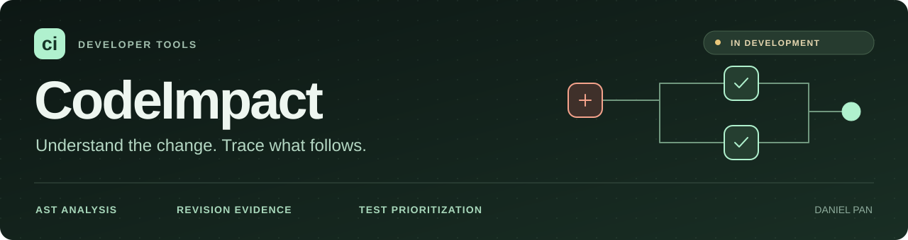
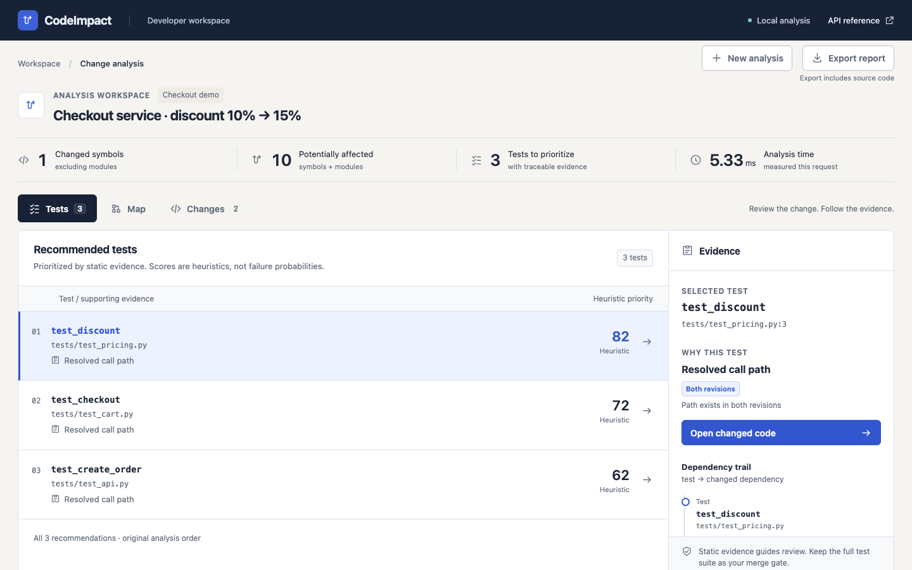

# CodeImpact

**Explainable change-impact analysis for Python.**

CodeImpact turns a code change into an inspectable dependency graph and a prioritized list of tests. Every recommendation includes a path back to a changed symbol, with source locations and evidence from the analyzed revisions.

**Status: actively in development.** The local application supports public GitHub PRs, uploaded snapshots, and committed local Git history. Hosted deployment and private-repository integration are planned.

[Quick start](#quick-start) · [Usage guide](docs/USAGE.md) · [Architecture](docs/ARCHITECTURE.md) · [Validation](docs/VALIDATION.md) · [CI](https://github.com/danielpan01/CodeImpact/actions/workflows/ci.yml)

## See the impact



*The light analysis workspace opens in Tests, with a coordinated evidence inspector. [Phone evidence](docs/media/mobile.png) · [Changed code](docs/media/changes.png) · [Before the redesign](docs/media/before-desktop.png).*

A change to `discount(total)` can affect an unchanged API test through `test_create_order → create_order → checkout → discount`. CodeImpact makes that relationship visible, then lets you inspect each dependency and the changed code.

## What works today

| Capability | What it provides |
| :--- | :--- |
| **Semantic change detection** | Compares Python ASTs, ignoring comments, whitespace, and source-line movement. |
| **Dependency analysis** | Indexes symbols and supported calls/imports; preserves removed dependencies across revisions. |
| **Function-local imports** | Resolves direct local import aliases after their binding statement; keeps ambiguous bindings unresolved and import fallback scoped to the function. |
| **Module import rebinding** | Suppresses misleading resolved calls when a module import name has competing bindings; preserves conservative import evidence. |
| **Scoped fallback selection** | Separates body edits from initialization changes; uses bounded possible references to avoid unrelated class/module recommendations without inventing resolved calls. |
| **Module-level partial calls** | Resolves bounded `functools.partial` bindings to unambiguous functions, with alias, re-export and lexical-scope guards. |
| **Argument-sensitive call paths** | Filters existing resolved paths when bounded argument guards establish a bypass or early exit; preserves other fallback evidence. |
| **Constructor and factory arguments** | Tracks bounded default overrides, partial factories, forwarded options and early exits; uncertain cases retain recommendations. |
| **Explainable test priorities** | Uses cycle-safe reverse traversal and deterministic heuristic scores, with a typed evidence path for each recommendation. |
| **Revision-aware code review** | Shows before/after source and labels dependencies as before-only, after-only, or shared; mixed-revision paths are explicit. |
| **Three input workflows** | Public GitHub PR URLs, JSON snapshot pairs, and a CLI for committed local Git history. |
| **Review workspace** | Light theme, compact report context, complete Tests list, Map, before/after Changes, and a coordinated evidence inspector; dedicated evidence navigation on phones and tablets. |
| **Inspectable reports** | Exportable JSON, source-export disclosure, exact analyzed GitHub revisions, and expandable before/after/mixed evidence. |
| **Authored correctness corpus** | Evaluates 25 complete snapshot cases against explicit dependency labels, records known mistakes, and validates typed paths and revision evidence. |
| **Real-source evaluation pilot** | Replays six pinned changes across three public repositories offline, with complete supported Python trees, verified provenance, draft-label review packs and explicit mistakes. |
| **Fresh-source regression gates** | Replays six additional changes from three previously unused repositories with a preserved first measurement and explicitly versioned regression baselines, checking source, label, evidence and result drift in CI. |

**Stack:** Python · FastAPI · Python AST · React · TypeScript · React Flow · Vite · pytest · Playwright

## Engineering decisions

- **Analyze source as data.** GitHub ingestion pins the merge base and PR head, verifies downloaded blobs, and bounds network requests and source size. It does not execute, import, or install the analyzed repository.
- **Keep deleted code in the analysis.** The dependency graph combines both revisions so removed functions can still explain potential impact.
- **Make uncertainty visible.** Resolved calls are distinguished from conservative module/import estimates. A path assembled across revisions is labeled accordingly.
- **Make results inspectable.** Recommendations retain exact edge IDs, source locations, and revision-specific evidence. Report schema 2.0 includes complete changed-file source.

The [architecture guide](docs/ARCHITECTURE.md) documents the graph model, scoring formula, report contract, and ingestion limits.

## Quick start

Prerequisites: **Python 3.12+**, **Node.js 24**, npm, Git, and Make. Ensure `python3` selects the required Python version.

```sh
git clone https://github.com/danielpan01/CodeImpact.git
cd CodeImpact
make setup
make dev
```

Open **http://127.0.0.1:5173**. API documentation is at **http://127.0.0.1:8000/docs**. Stop both services with Ctrl-C.

### A one-minute walkthrough

1. Choose **Load demo** on the input screen; it analyzes a discount change from 10% to 15% and opens **Tests**.
2. Select `test_create_order` and follow its dependency path. On phones/tablets, use **Back to results** to return from evidence.
3. Choose **Open changed code** to inspect the before/after implementation.
4. Explore the **Map**, inspect each edge's evidence, and export the report. **New analysis** reopens PR input, snapshot upload, and the demo.

You can also paste a public GitHub PR URL or upload snapshot pairs. See the [usage guide](docs/USAGE.md) for CLI examples, a deleted-function fixture, API requests, configuration, and troubleshooting.

## Evaluate the analyzer

The [authored correctness corpus](docs/CORPUS.md) contains 25 small, complete
base/head examples with explicit affected, unaffected and unclassified test labels.
Run it from the repository root with the pinned environment:

```sh
make evaluate
# Full results, labels, snapshots and typed paths: reports/corpus-evaluation.json
.venv/bin/python -m codeimpact.evaluate --case local_import \
  --output reports/local-import.json
```

Observed agreement with these authored dependency labels: **23 true positives,
2 false negatives, 0 false positives, 32 true negatives**. Precision is **23/23
(100%)**; recall is **23/25 (92.0%)**. Two unclassified recommendations are reported
separately. All 18 supported and 7 known-limitation cases enter the totals.
Known discrepancies fail evaluation if they change, including improvements needing
deliberate review. Passing means the recorded baseline matches, not zero mistakes.

Earlier milestones fixed a function-local import miss and removed a stale resolved
call after a module import was rebound. The selection refinement now removes all
six recorded authored false positives: unrelated sibling functions, shadowed or
rebound names, conditional definitions and inherited-method controls. It preserves
the affected selections and keeps uncertain method references labeled conservative.
Fixture injection and runtime imports remain the two measured misses. Sources and
authored labels are unchanged; discrepancy annotations were deliberately updated.
The [historical baseline](corpus/selection-baseline-v1.json) retains prior results.
These are small authored fixtures, not externally validated ground truth,
production accuracy or proof that a test fails. Fixture code is never executed.
Statement coverage measures executed lines, not correctness; passing regression
tests does not establish general accuracy. Keep the full test suite as the merge gate.

### Real-repository evaluation v1

Run the separate pinned dataset without network access:

```sh
make evaluate-real
# reports/real-evaluation.json: selected IDs, labels, counts and complete evidence
```

The six changes cover MarkupSafe, ItsDangerous and Schedule. Sources, licenses,
revision pins and hashes are retained under `corpus/real`, separately from the
25 authored cases. Labels were drafted from source before analysis and are **not
independently reviewed**. No upstream source or tests were executed.

The initial evaluation selected 171/201 test definitions with 102 false positives.
After class/module selection and bounded argument tracking: **56/201 selected;
45 TP, 0 FP, 0 FN, 123 TN**, plus **11 selected out of 33 unclassified tests**.
Draft-label precision is 45/45 (100%) and recall is 45/45 (100%). The first
refinement removed 98 false positives; constructor/factory argument tracking now
removes the final four ItsDangerous recommendations by distinguishing explicit
overrides, forwarded options, early exceptions and unrelated classes. Sources and
labels were not changed. Uncertain tests remain separate in the report.

These cases informed the fix and are now a development/regression sample, **not
an unseen accuracy benchmark**. Zero labeled misses does not show that omitted
tests are safe to skip. Sources, labels, review status and provenance stayed fixed.
Read the [actual results and remaining mistakes](docs/REAL_EVALUATION.md),
[source/label protocol](corpus/real/README.md), and
[201-label review pack](corpus/real/REVIEW.md).

### Fresh-repository evaluation v2

```sh
make evaluate-real-v2
# reports/real-v2-evaluation.json
```

Six changes from Atomicwrites, Python Slugify and Cachetools were labeled before
running the unchanged `bef99db` analyzer. The original measurement is preserved:
**65 TP, 284 FP, 44 FN, 166 TN; 362/581 definitions selected**.

Bounded module-level `functools.partial` binding repaired **all 44 Slugify misses**,
while initially adding seven false positives. That intermediate baseline remains
preserved: **109 TP, 291 FP, 0 FN, 159 TN; 413/581 selected**.

Bounded argument-sensitive call filtering now removes **exactly those seven false
positives**, retaining all affected selections. Current results are **109 TP, 284 FP,
0 FN, 166 TN; 406/581 selected**, including **13 of 22 uncertain definitions**.
Draft-label precision is 109/393 (27.74%); recall is 109/109 (100%). Known
`allow_unicode=True` bypasses and early type-validation exits can filter resolved
call paths. Unknown/mutated arguments and other module/import fallback remain
conservative. Existing Slugify and Cachetools fallback mistakes remain recorded.

All original snapshots, labels, provenance, discrepancy annotations and both prior
v2 baselines are unchanged. The separate
[`argument-guards-v1` baseline](corpus/real-v2/baselines/argument-guards-v1.json)
records current source hashes, results and remaining mistakes. The offline gate
verifies both historical receipts and the active baseline; it never accepts drift
automatically. V2 is **development/regression data**, not unseen validation. Labels
remain agent drafted, with no upstream tests executed. See
[current and historical v2 results](docs/REAL_EVALUATION_V2.md) and the
[source-only review pack](corpus/real-v2/REVIEW.md). Keep the full test suite as the
merge gate; these measurements do not establish that omitted tests are safe.

## Quality checks

```sh
make check
make evaluate
make evaluate-real
make evaluate-real-v2
cd web
npm run install:browsers
npm run test:e2e
```

[GitHub Actions](https://github.com/danielpan01/CodeImpact/actions/workflows/ci.yml) is configured to run Python linting and formatting, strict type checks, application tests, the frontend production build, all three offline evaluations, and desktop/mobile browser tests. The [validation record](docs/VALIDATION.md) preserves observed local results and distinguishes them from remote CI runs.

## Scope & next steps

CodeImpact is a developer review tool. Static Python analysis is incomplete for dynamic dispatch, runtime imports, inheritance, re-exports, and pytest fixtures. Scores express review priority, not failure probability; a missing path does not establish safety. **Keep the complete test suite as the merge gate.**

[Frontend milestone 1](docs/FRONTEND_ROADMAP.md) is implemented locally: a warm light
workspace, dark navigation, shared controls, a Tests-first review flow, redesigned
Map/Changes/source panes, and an evidence panel with phone/tablet back navigation.
The screenshots show the running application with real analysis results. Analyzer
behavior and all evaluation baselines are unchanged.

Next is interaction refinement: test search/filter/sort, graph path focus and large-report
navigation, then dark theme and further accessibility/device polish. No independent
usability study or accessibility certification is claimed.

Independent review of both real-source datasets and bounded protocol-aware fallback
narrowing remain on the roadmap, motivated by the Cachetools mistakes. General
dynamic dispatch and further fallback precision remain separate work. Worker isolation and hosted deployment remain later milestones. GitHub App authorization for
private repositories, persisted jobs, and cross-request caching are not implemented.
See the [build plan](docs/BUILD_PLAN.md).

Direct function-local imports, aliases, relative imports and `src/` layouts are supported within the [documented scope](docs/ARCHITECTURE.md#bounded-function-local-imports). The [module binding scan](docs/ARCHITECTURE.md#bounded-module-level-rebinding) requires one direct import and no competing module-scope bindings; bare annotations and separate function/class body bindings do not invalidate it. Conditional imports, competing bindings and closure propagation remain conservative. The bounded selection filter is documented in [Architecture](docs/ARCHITECTURE.md#scoped-aggregate-fallback). Unsupported initialization and protocol changes retain conservative fallback; the [argument-tracking boundary](docs/ARCHITECTURE.md#bounded-constructor-and-factory-arguments) documents the exclusions now supported.

Exports contain the full before/after source of changed files, including content outside bounded on-screen previews.

## Project guide

- [Analyzer and API](src/codeimpact/) · [Dashboard](web/) · [Tests](tests/)
- [Usage](docs/USAGE.md) · [Architecture](docs/ARCHITECTURE.md) · [Validation](docs/VALIDATION.md)
- [Corpus guide and measured results](docs/CORPUS.md) · [Authored cases](corpus/cases/)
- [Contributing](CONTRIBUTING.md) · [Security](SECURITY.md) · [Roadmap](docs/BUILD_PLAN.md)

Built by [Daniel Pan](https://github.com/danielpan01).
