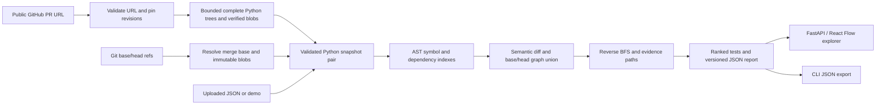

# Architecture

CodeImpact answers: **Which tests deserve attention after this Python change, and why?**
The application is a stateless vertical slice. Its value lies in an explainable analysis
engine; the API and graph are ways to inspect the engine's evidence.



## Symbols and semantic comparison

Each node has an ID `repository/path.py::qualified.name`, source lines and a kind:
module, class, function or test. Tests are functions named `test_*` inside `test_*.py`
or `*_test.py` files, including class methods. This is a discovery heuristic, not
pytest collection. Parametrization and fixture injection are not modeled.

`ast.dump(..., include_attributes=False)` is SHA-256 hashed for every successfully
parsed module, including empty and comment-only modules, to compare semantics
without source locations. Comments, whitespace and moved lines do not count. A
function body, signature, decorator or annotation change can count. Modules include
the whole AST, so a function change also changes its module. Classes include methods;
nested functions also affect their enclosing function. This deliberately favors recall.

The collector recursively visits direct function/class bodies; definitions inside
conditional/loop/try blocks are not currently indexed. Duplicate module paths such
as `a.py` and `src/a.py` are rejected. Parse failures remain indexed as modules with
visible warnings and raw-source fingerprints. Distinct invalid revisions and
valid/invalid transitions count as changes; identical invalid source keeps its
warning without inventing a change. Report warnings include both revisions, so a
repaired file can still carry its base-revision parse warning. Renames are represented
as removal and addition.

## Graph semantics

Edges point **from dependent to dependency**:

- `call`: a supported lexical/imported call resolves to a known symbol.
- `import`: a module imports a known module.
- `module`: a symbol depends conservatively on its own module's initialization.

No runtime import takes place. Selected `import`, `from ... import`, aliases,
relative imports and a conventional leading `src/` directory are supported.
Parameters and local assignments that shadow a callable suppress that precise edge.
Re-exports, inherited methods, local imports, module-level rebinding, closures with
complex assignments and dynamic dispatch are incomplete. Even a resolved edge is a
static inference, not proof that a call executes.

Both revisions contribute nodes and edges. Removed functions stay visible and old
callers still propagate impact. A union path may combine edges from different
revisions, making the estimate intentionally conservative. Removed tests are never
recommended for execution in head.

Each typed edge retains separate before/after evidence arrays and revision presence.
Call sites, import statements and conservative definition-to-module edges include
source and target line ranges. Repeated sites at distinct lines are retained;
identical text/location entries are deduplicated. Shared edges may have different
locations or evidence text in each revision. Their identity excludes source locations.

## Impact and ranking

Multi-source reverse breadth-first search starts at changed nodes. A visited set
terminates cycles. Sorted inputs and adjacency lists make ordering deterministic.
One pass traverses all edges; another traverses only call edges from changed
non-module symbols. A call path is preferred when available; otherwise the report
labels the module/import fallback. The stored path runs **test → ... → changed node**.
Its `evidence_edges` identify the exact typed edges for consecutive hops. A tied pair
chooses `call`, then `import`, then `module`, without changing the existing node BFS
or score. The intersection of those edges' revision sets determines `path_revision`.
An empty intersection is explicitly `mixed`; it describes this shown path, not all
possible paths. A zero-hop changed test has no edges and uses its node presence.

The current priority formula is:

```text
clamp(1, 100,
      (90 for a call path, otherwise 50)
      - 10 × dependency distance
      + min(10, direct dependent count at the changed endpoint))
```

Scores sort descending with symbol ID as the tie-breaker. They are not trained or
calibrated failure probabilities. A directly modified test is explained separately.
The full test suite remains the correctness gate. A missing path means only that
this analyzer did not find one.

AST parsing/indexing is approximately linear in input size for simple cases. Two
graph traversals visit O(V+E) graph elements, but copying full evidence paths adds
O(V × path length) storage/work and can be quadratic on a long chain. Current sorting
and repeated nested AST walks add overhead. A later predecessor-map representation
can make traversal storage linear and materialize paths only for selected tests.
The CLI currently launches Git for each blob/size; batch object reads are a useful
measurable optimization once correctness is stable.

## Interfaces and UI

`GET /health`, `GET /api/demo`, `GET /api/demo/snapshots`, `POST /api/analyze` and
`POST /api/github/pr` are implemented. OpenAPI is at `/docs`. All report-producing
interfaces (including the CLI) emit schema 2.0, described below.

React Flow displays dependency arrows, search, module filtering, selection and
evidence highlighting using exact edge IDs. The dashboard uses real API results,
including the demo.
Metrics include module nodes where labeled. Search filters the visible graph only;
it does not recompute recommendations. The UI exports a report; its upload expects
the separate snapshot-pair input schema.

The Changes view groups added/modified/removed symbols by file. Open changed code
from a recommendation preserves the selected test's explanation and opens the last
node in its path. Selecting another change directly shows that symbol's own details.
Before/after panes use inclusive source ranges, including the first decorator's `@`
and multiline parentheses. Module ranges use Python physical newlines (LF, CRLF, CR),
not Unicode separators embedded in string literals. Existing node `line` still points
to the definition; changed-code ranges may begin earlier at its decorators.

Source is passed only as React text children, never HTML or executable source. Each
pane displays at most 120 lines, 12,000 UTF-16 source code units including rendered
newlines, and 500 code units of source per line (excluding its newline). Generated
line numbers and truncation labels are outside that source-character budget.
Any omitted lines/characters have a visible truncation notice. Scrolling supports
keyboard access; narrow screens stack panes and the explanation. Previews may omit
the changed statement in a large module; select the individual definition where
available or export the full source. There is no inline line-diff or rename matching.

## Report 2.0 contract

This is an intentional breaking report version. `AnalysisRequest`/snapshot upload
input and GitHub request input remain unchanged. IDs, edge direction, semantic
comparison, ranking and deleted-test exclusion remain unchanged. The API's response
models/OpenAPI, CLI JSON, TypeScript types and browser exports share this version.
The dashboard rejects older response versions with an actionable restart message.
There is no old-report importer or automatic conversion; re-analyze the original
snapshots. Old reports alone lack enough source/revision information to reconstruct
2.0 faithfully. The package/API release number is independent of the report schema.

| Field | Contract |
| --- | --- |
| `schema_version` | Literal `"2.0"` |
| `changed`, `removed`, `impacted`, `nodes` | Existing IDs/order/meaning retained; union nodes prefer after metadata |
| `changes[]` | One entry per changed ID: `symbol`, `path`, `status` (`added`, `modified`, `removed`), nullable `before`/`after` inclusive `{line, end_line}` |
| `source_files[]` | Sorted changed file paths only; each `before`/`after` is null for absent file, otherwise `{text, parse_status}` with complete original text and `parsed`/`unparseable` |
| `edges[]` | Sorted by `(source, target, kind)`; stable `id`, `source`, `target`, `kind`, `revision` (`before`, `after`, `both`) and separate `before`/`after` evidence arrays |
| Edge evidence | Each item has `text`, `location` and `target_location`; locations contain `path`, `line`, `end_line`, from that revision. An absent revision has an empty array. This replaces 1.0's single `evidence` string. |
| `recommendations[].evidence_edges` | Ordered edge IDs, exactly one per consecutive pair in the retained `evidence_path`; empty for a changed test itself |
| `recommendations[].path_revision` | `before`, `after`, `both`, or `mixed` for the entire shown typed path |

Edge IDs are SHA-256 of Python `json.dumps((source, target, kind), ensure_ascii=True)`
encoded as UTF-8 (default comma/colon spacing). They are deterministic across input
ordering and line movement. Evidence arrays sort by start line, end line, then text.
Both locations are inclusive, one-based lines. Empty modules retain the existing
synthetic line-1 node/range; the UI displays "Empty file" with no fictitious code line.
A null symbol range means not indexed in that revision; if its file is unparseable,
the UI reports unavailable definitions and shows bounded raw file text. That must
not be confused with a file's null (absent) source entry or empty text.

Exports now contain source code, explicitly disclosed beside the export button.
The report stores complete changed files once per revision, shared by all symbol
ranges. This adds at most the existing two snapshots' 4,000,000 raw UTF-8 source bytes
in aggregate, before JSON escaping/metadata. No source fetches occur while selecting
code, and no current branch content is substituted. PR before means merge base;
after means pinned head. Upload/demo/local-Git source comes from the exact request
already analyzed. Network and snapshot ingestion limits below are unchanged.

## Public GitHub ingestion

`github.py` owns URL validation, provider models, immutable-object reads and network
bounds. It returns validated `AnalysisRequest` snapshots, source metadata and input
warnings. `api.py` owns the HTTP client and optional server credential, invokes this
reader, and runs the shared analyzer in a thread pool. The frontend only posts
`{"url":"https://github.com/owner/repo/pull/number"}` and renders the returned report.

Only exact HTTPS github.com PR URLs are accepted: no credentials, ports, queries,
fragments, suffixes or alternative hosts. Requests go to fixed `https://api.github.com`
paths constructed from validated repository names and full 40-character SHAs. Provider
download URLs are never followed; redirects fail with an instruction to use the
current PR URL. Both base and head repositories must be public, even with a token.

The reader fetches PR metadata once and pins target base and head SHAs. It requests
the comparison of those SHAs, using `head-owner:head-sha` for fork support, and uses
only its merge-base metadata. The comparison's paginated commits and limited diff
files are **not** input to the graph. Instead, each pinned commit's complete recursive
tree supplies all ordinary `.py` blobs in scope, including unchanged tests/callers.
Truncated listings fail rather than produce a partial report. There is no pagination
fallback or archive extraction. Renames remain removal plus addition.

Commit/tree identities are checked. Blob base64 is decoded strictly; the content's
Git object hash and sizes must match the requested object and tree entry. UTF-8 is
required. Blobs are deduplicated by SHA within one import, not cached across requests.
Downloaded Python stays in memory as strings and is only parsed as data. Symlinks,
submodules and Python files under `.venv`, `venv`, `node_modules`, `vendor` and `.git`
are skipped with counts and example paths in warnings. Thus "complete" means all
regular Python source in this explicitly supported scope, not all repository content.

| Bound | Limit |
| --- | --- |
| Incoming HTTP body | Existing 6,000,000 bytes |
| Python source per revision | Existing 300 files, 200,000 bytes/file, 2,000,000 total bytes |
| Entries in each recursive tree | 20,000, counting all file types and directories |
| Decoded response body | 4,000,000 bytes; blob JSON 400,000 bytes |
| Total decoded response bytes per import | 20,000,000 bytes |
| Requests per import | 650 maximum, no automatic retries |
| Concurrent upstream requests per import | 4 maximum |
| HTTP timeouts | 5 seconds connecting, 10 seconds read/write/pool inactivity |
| Whole network import deadline | 60 seconds, including queued blob requests |

Pending blob downloads are cancelled and awaited when one fails. Bounds are per
import; they are not global multi-user quotas or process isolation. The 60-second
deadline covers ingestion, not analyzer CPU time. Timings in report stats continue to
measure analysis, excluding network retrieval. Public hosting still needs worker
isolation and service-wide admission/resource controls.

The PR response is an additive `GitHubPRReport`: schema 2.0 report fields
plus a required `source` object (`kind`, repository/head repository, PR number/URL,
title, `base_sha`, `head_sha`, `merge_base_sha`, `analyzer_version`). Demo and upload
responses use the same 2.0 core without GitHub provenance. `base_sha` records the
target revision; the actual before input is `merge_base_sha`. A new submission may
observe a new head; an in-flight
analysis never switches to branch names. Export preserves all this metadata.

Errors contain `detail: {code, message, retryable}`. Invalid URLs, unsupported/large
input, private repositories and incomplete trees return 422; missing PRs/revisions
404; rate limits 429; upstream/network failures 502/503; timeouts 504. The existing
body-size middleware still returns 413 with a string detail. Error messages do not
echo upstream bodies, credential-bearing URLs or validation input. Optional
`CODEIMPACT_GITHUB_TOKEN` is read only on the server and sent as a GitHub API header.
No auth UI, secret persistence or automatic token discovery is implemented.

The form disables duplicate submissions, announces loading, clears stale results on
failure and offers retry of the same PR. Revisions expand without changing the graph;
keyboard submission, mobile wrapping, JSON export and recovery have browser coverage.
Browser tests use a test-only API dependency override for GitHub transport; the real
reader, validation, analyzer and serialization still run. Development uses live GitHub.

No database, queue or credentials are required. A future job layer can wrap
ingestion and analysis without altering either module's data contracts. Durable jobs,
access control and deployment remain separate future work. Any cross-request cache
must include repository, pinned analyzed revisions, analyzer version and settings.

Provider references: [PR metadata](https://docs.github.com/en/rest/pulls/pulls#get-a-pull-request),
[comparison and merge base](https://docs.github.com/en/rest/commits/commits#compare-two-commits),
[recursive trees and truncation](https://docs.github.com/en/rest/git/trees#get-a-tree),
[Git blobs](https://docs.github.com/en/rest/git/blobs#get-a-blob),
[HTTPX timeouts](https://www.python-httpx.org/advanced/timeouts/).

References: [Python AST](https://docs.python.org/3/library/ast.html),
[FastAPI testing](https://fastapi.tiangolo.com/tutorial/testing/),
[React Flow](https://reactflow.dev/learn), [Vite](https://vite.dev/guide/).
