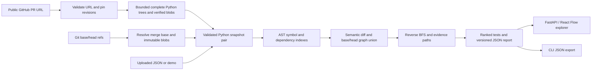

# Architecture

CodeImpact answers: **Which tests deserve attention after this Python change, and why?**
The application is a stateless vertical slice. Its value lies in an explainable analysis
engine; the API and graph are ways to inspect the engine's evidence.



## Symbols and semantic comparison

Each node has an ID `repository/path.py::qualified.name`, source lines and a kind:
module, class, function or test. Tests are functions named `test_*` inside `test_*.py`
or `*_test.py` files, including class methods. This is a discovery heuristic, not
pytest collection. Parametrization and fixture injection are not modeled.

`ast.dump(..., include_attributes=False)` is SHA-256 hashed for every successfully
parsed module, including empty and comment-only modules, to compare semantics
without source locations. Comments, whitespace and moved lines do not count. A
function body, signature, decorator or annotation change can count. Modules include
the whole AST, so a function change also changes its module. Classes include methods;
nested functions also affect their enclosing function. These full fingerprints remain visible in Changes; propagation seeds are filtered as described below.

The collector recursively visits direct function/class bodies; definitions inside
conditional/loop/try blocks are not currently indexed. Duplicate module paths such
as `a.py` and `src/a.py` are rejected. Parse failures remain indexed as modules with
visible warnings and raw-source fingerprints. Distinct invalid revisions and
valid/invalid transitions count as changes; identical invalid source keeps its
warning without inventing a change. Report warnings include both revisions, so a
repaired file can still carry its base-revision parse warning. Renames are represented
as removal and addition.

## Graph semantics

Edges point **from dependent to dependency**:

- `call`: a supported lexical/imported call resolves to a known symbol.
- `import`: a module, or a function with a supported direct local import, imports a known module.
- `module`: a symbol depends conservatively on its own module's initialization.

No runtime import takes place. Selected `import`, `from ... import`, aliases,
relative imports and a conventional leading `src/` directory are supported.
Parameters and local assignments that shadow a callable suppress that precise edge.
Function-local imports and module import rebinding have the bounded support described
below. Re-exports, inherited methods, runtime mutation, closures with complex assignments and
dynamic dispatch are incomplete. Even a resolved edge is a
static inference, not proof that a call executes.

### Bounded module-level rebinding

Module import aliases are audited before connecting calls. A precise imported target
requires **one direct import binding and no competing binding in the module's own
scope**. Assignments or deletions invalidate that imported name; duplicate imports
(even identical ones), imports under compound statements and wildcard competition
are treated as ambiguous. The existing absolute/relative imports, aliases and `src/`
layouts remain supported when this check passes.

The syntax-only scan recognizes:

- Plain, chained, tuple/list/starred and annotated assignments with a value;
  augmented assignments, assignment expressions and deletion targets.
- Function, async-function, class and Python 3.12 type-alias definition names.
- Bindings under module-level `if`, loops, `with`, `try`/`except`/`finally` and
  `match`, including iteration targets, context-manager targets, exception names
  and pattern captures. Branches are not evaluated.

`name: Type` without a value does not assign a module name. Attribute/subscript
stores do not rebind their root object name. A function/class/lambda body has a
separate scope and is not scanned for ordinary module bindings. Their definition
headers (defaults, decorators, bases and annotation expressions) are scanned for
enclosing-scope stores. Comprehension iteration targets remain separate; assignment
expressions in result/iterable/filter expressions conservatively count as possible
enclosing-scope bindings. Type-parameter and deferred-annotation execution semantics
are not interpreted.

This is flow-insensitive: a competing binding anywhere in the module suppresses
that import name, even if unreachable or followed by an import that could restore
it. Source order is not used to guess when a function will execute. An ambiguous
imported root cannot fall through to a same-named definition or another guessed
replacement. Supported function-local imports retain their own resolution and
can override an ambiguous module name. Ambiguous module names and unresolved calls
produce diagnostics.

Existing direct module-to-module import edges remain, with their original locations.
No new conditional-import fallback edges are added. A caller can therefore still be
recommended by conservative module/import evidence after its precise call is removed.
The ranking formula is unchanged, but the new path or changed incoming-edge count
can change a priority score. Each revision is audited independently before the
unchanged graph union: a justified before-only call must survive a head rebind.

Global writes executed inside separate function/class bodies, mutations of callable
attributes/shared objects, reflective namespace changes, re-export propagation,
runtime imports and general control-flow analysis are outside this correction.
The scan does not infer which replacement object is callable or execute source.

### Bounded module-level `functools.partial` calls

`partial_bindings.py` adds an independent syntax-only resolver used only for
module partial candidates. A candidate is one direct simple-name assignment
(including an annotated assignment) to an unambiguous imported
`functools.partial` or module alias. A local snapshot named `functools` disables
stdlib identification. The captured callable must resolve to a plain, undecorated
function through earlier direct imports/aliases, relative imports, a `src/` layout,
or an earlier same-module definition. Bound arguments must be small immutable
literal expressions (at most 64 AST nodes per argument); unpacking and dynamic
expressions are declined. No constructor, bound method, nested partial, function-local
partial construction, imported partial binding, or arbitrary factory is inferred.

Target re-exports are followed for at most 16 hops. Explicit package re-exports
retain the import's module/member boundary, avoiding a same-named submodule collision.
Slugify also requires wildcard re-exports: those are followed only when every source
module has a complete static export inventory and exactly one exports the target.
A single literal list/tuple `__all__` (at most 256 names), or the public names from a
module without `__all__`, supplies that inventory. Unknown/dynamic/competing stars,
conditional stars, dynamic module attribute hooks, export-list reads/mutations,
recognized export-source namespace reflection and import cycles decline precision. This support is confined to resolving
a partial's target; ordinary wildcard call handling remains unchanged.

The partial, factory and target must have one binding with no competing assignment,
delete, definition, conditional binding, wildcard, observed global/nonlocal declaration,
or direct attribute/subscript mutation. Construction must follow its captured bindings;
a same-file call must textually follow construction. This conservative source-order
rule does not infer when a function actually runs. Separate functions do not leak
ordinary local bindings. Local/enclosing parameters, imports, assignments, annotations,
definitions and declarations block the global partial. Lambdas and comprehensions
may use it only without shadowing the name. Unsupported candidates reserve their
name instead of falling through to a same-named function.

A supported invocation creates the existing caller-to-underlying-function `call`
edge. Evidence names the partial's source location, with the actual invocation as
source range and the underlying function as target range. Construction itself adds
no invocation edge or synthetic node. Both revisions resolve independently, so
before-only/deleted-target evidence survives. Stable IDs, edge direction, schema 2.0,
selection code and scoring formula remain unchanged; new edges can change paths and
scores. A resolved partial target does not establish branch reachability, runtime
execution or valid arguments. General monkeypatching, reflective alias mutation,
control flow and dispatch-argument pruning remain outside this bounded inference.

### Bounded function-local imports

An `import` or `from ... import` statement directly in a function/async-function
body can bind a local alias. This includes methods and separately indexed nested
functions, absolute/module aliases, relative imports based on the containing
package, and conventional `src/` layouts. Import syntax is decoded as data using
the same helper as module imports; no imported source is executed or installed.

A local call resolves only after the import's end position, using line and column
offsets so same-line calls before and after an import differ. All local import
names reserve their scope even when unsupported: a call before the import or an
ambiguous binding cannot fall through to a same-named module alias. Aliases never
leak into sibling functions or overwrite the module's alias table.

Support deliberately requires one import binding per name and no competing
parameter, assignment/deletion, definition, exception/pattern capture, `global` or
`nonlocal` declaration. Repeated imports, imports under conditionals/loops/try, and
overdeep relative imports are unresolved. Attribute/subscript mutation through an
alias and possible nested nonlocal/attribute writes also suppress its precise call.
Assignments in nested definition headers (defaults, decorators and class bases),
including lambda defaults, are checked in the enclosing scope. Ordinary nested
body assignments retain their separate scope.
Competing bindings are checked across the whole function rather than interpreted
statement by statement; even a later or unreachable rebind can suppress an earlier
call. This conservative boundary can miss dependencies and is not control-flow
analysis. Unsupported/ambiguous import bindings emit warnings.

Nested functions resolve their own imports but do not inherit precise outer local
aliases; those outer names block incorrect fallback to module globals. Local
aliases are not resolved inside lambda/comprehension/generator-expression scopes.
Comprehension targets with the same name can conservatively suppress resolution
elsewhere in the function. Class-body imports, wildcard binding semantics,
reflection, runtime imports and object-alias mutation tracking remain outside this
milestone. Direct syntax does not establish that a statement executes at runtime.

Every supported direct import also adds a conservative `import` edge from its
**owning function** to the imported module, with the import statement's source
range. It is not promoted to an edge from the entire containing module. This lets
a changed module constant reach its caller without contaminating unrelated sibling
functions. Such an import edge can remain when rebinding suppresses a precise call;
it describes the conservative dependency on importing the module. Conditional
imports do not get these new fallback edges. Resolved call paths retain preference
over fallback paths. The selection refinement below filters aggregate-only
fallback without changing the scoring formula.

Both revisions contribute nodes and edges. Removed functions stay visible and old
callers still propagate impact. A union path may combine edges from different
revisions, making the estimate intentionally conservative. Removed tests are never
recommended for execution in head.

Each typed edge retains separate before/after evidence arrays and revision presence.
Call sites, import statements and conservative definition-to-module edges include
source and target line ranges. Repeated sites at distinct lines are retained;
identical text/location entries are deduplicated. Shared edges may have different
locations or evidence text in each revision. Their identity excludes source locations.

## Impact and ranking

Multi-source reverse breadth-first search starts at propagation seeds. A visited set
terminates cycles. Sorted inputs and adjacency lists make ordering deterministic.
One pass traverses all edges from executable changes; another traverses only call
edges from non-module seeds. Aggregate-only changed modules have separate filtered
fallback passes. A call path is preferred when available; otherwise the report
labels conservative module/import evidence. The path runs **test → ... → changed
node**. Typed `evidence_edges` identify every hop; ties prefer `call`, `import`, then
`module`. Across fallback passes, equal-length paths use lexicographic path order.
The intersection of edge revision sets determines `path_revision`; an empty
intersection is `mixed`. A changed test has a zero-hop path and its node presence.

### Scoped aggregate fallback

`selection.py` separates full display fingerprints from propagation. A body-only
method edit still changes its method, enclosing class and module in the report,
but the class is not a constructor-impact seed solely because its method changed.
Function/test changes and additions/removals remain seeds. Class `__init__`/`__new__`
changes seed constructor users. Module/class assignments, bases, decorators,
potentially effectful defaults and parse failures retain broad initialization
fallback. Builtin `@property` and simple `name = property(getter)` declarations are
normalized as deferred accessors only when the builtin is not shadowed.

For an aggregate-only module, entering a symbol through a `module` edge or a
function-local `import` edge requires a possible source reference to an edited
declaration, in either revision. These checks follow lexical/import aliases,
passed callables, conditional declaration names, member spellings, simple source
constructors, fluent/factory returns, properties and consistent stored-field
values. Known incompatible receivers can exclude an unrelated member. Uncertain
receivers retain possible same-name members in their source import scope; inherited
bodies also consider known subclasses. Competing parameters/bindings, external
bases, custom allocation, field mutations and reflective writes prevent the
corresponding type exclusions. Recognized builtin calls include `repr`, `str`,
`len`, `bool`, `iter` and `next`, with their bounded fallback protocols; shadowed
builtins do not invent dispatch. Containers remain uncertain because protocols
can touch their elements. Unmodeled special-method changes retain broad fallback
and a warning rather than suppressing operator dependencies.

**These are possible references, not new resolved call edges.** Every retained
recommendation still uses existing typed module/import evidence. No source is
executed. Node/edge IDs, graph direction, before/head evidence, removed symbols,
full changed-file source and report schemas are unchanged. A subsequent bounded
argument filter handles eligible class-default initialization changes as described
below; other initialization effects still propagate conservatively.
Arbitrary mutation, reflection, descriptors, implicit protocols, closure/data flow,
fixture injection and runtime imports remain incomplete. This filter is not a
proof that unselected tests are independent.

Reference recursion is capped at 24 levels, becoming unknown at the boundary.
Dependency exploration is capped at 2,000 visited symbols per check; exceeding it
retains fallback with a warning. Caches are request-local. Each aggregate changed
module may add a graph traversal and reference checks, so cost can increase with
changed modules; this is not a linear-time or adversarial-isolation guarantee.

### Bounded constructor and factory arguments

`arguments.py` adds a contextual exclusion check for modules whose **entire** AST
difference is confined to supported class default assignments and passive helper
function additions/removals referenced by those assignments. Other module effects,
constructor body changes, descriptor construction, custom `staticmethod`, class
creation hooks, decorated/customized classes and unsupported bases keep the existing
fallback. Eligible values are literals, unadorned source functions, simple aliases
of those values and explicit `hashlib` digest references (`md5`, `sha1`, `sha224`,
`sha256`, `sha384`, `sha512`), optionally wrapped in builtin `staticmethod`.
These names are data; no digest or upstream callable is imported or invoked.
The surrounding module/class bodies must also have passive initialization: arbitrary
expressions, definition-header effects and conditional initialization decline this
filter even when those statements themselves are unchanged.

The AST query carries positional and keyword arguments, known `*`/`**` expansions,
keyword-only parameters, source wrapper calls, `functools.partial` keyword overrides,
instance fields and option dictionaries through known constructors/methods. It can
follow stored class factories, bounded collection iteration/comprehensions and
forwarded fallback configurations. Unknown conditions explore alternatives. Omitted nonliteral or mutable definition
defaults retain fallback, preserving captured values and shared-default uncertainty. Literal
identity/equality/membership checks can establish an early `raise` before a default
read; a read before that raise still retains impact. Partial known text can prove
membership in a fixed suffix without guessing unknown characters. Reading a changed
default or helper retains the dependency in either revision. Graph edges are not
added, removed or upgraded to precise dispatch.

A local module/class `@pytest.fixture(...)` provider is considered only when its
body is a single return (apart from a docstring), its parameters are limited to
`self`/`request`, and its factory variants are statically available. Direct literal
data returns can supply argument values too. This narrowly supports fixture-provided
partial factories and constant options; general fixture dependency discovery,
conftest resolution, arbitrary setup effects and inherited fixture contexts remain
unsupported. It does not repair the authored fixture-injection miss. Function-local
aliases become available only after their direct import statement.

Unresolved arguments/calls, arbitrary imported settings that may be `None`, mutable
or conflicting bindings, unknown iteration counts, implicit protocols on source
or unknown objects, reflection, unsupported statements and source objects escaping
to external calls keep recommendations. Known scalar/container values and opaque
external data results are carried without executing operations from analyzed source.
A small set of literal operations, UTF-8/ASCII conversion and builtin/standard-library
API shapes are modeled internally; arbitrary Python behavior is not interpreted.

Limits per query: 12,000 AST/data-flow steps, 24 call/lookup levels, 16 alternatives
or branch states, 64 literal sequence/comprehension items and 4,096-character/byte
literals. Budget exhaustion or recursive uncertainty retains fallback. Caches are
request-local. Each eligible changed module is traversed separately so excluding
one default dependency cannot erase a path to a different change. Both snapshots
must support exclusion; existing deleted-symbol and mixed-revision handling remains.
A new passive helper import from a module already imported in both revisions does
not independently fan out to every test in the importing module. Prior initialization
must be established by an earlier eager import (including its eager dependencies)
or by a retained import in the same statement; moving initialization earlier keeps
broad fallback. In either case, its other changes
and actual helper references still propagate.

This is bounded source dependency analysis, not full Python execution or proof that
unselected tests are safe. Arbitrary factories, mutation, descriptors, dispatch,
fixture injection and runtime imports remain incomplete. The six pilot cases
informed these fixes; they are regression data, not an unseen accuracy benchmark.

### Bounded argument guards on resolved call paths

`call_arguments.py` is a selection-only filter for changes confined to existing,
undecorated, top-level function bodies. The entire module difference must fit that
shape; additions/deletions, signature/default/decorator changes, class edits and
initialization changes decline this filter. Reaching any edited function body counts
as a dependency regardless of which edited lines execute.

The index retains internal per-call AST bindings, including captured partial arguments.
These are not serialized. A test-to-function call contribution can be excluded only
when every recorded invocation in both revisions avoids all edited bodies for that
module. Tests themselves changed, module/class targets and paths supported only by
fallback are not excluded. Queries are grouped by changed module so one exclusion
cannot erase evidence to a different edit. Import/module fallback is preserved;
ordinary direct calls can therefore remain conservatively recommended even after
a resolved route is filtered. All graph nodes/edges, stable IDs, revision evidence,
core report 2.0 and scoring formula remain unchanged.

The query carries literal positional/keyword arguments, immutable defaults, bounded
known `*`/`**` expansion, forwarded parameters/options and call-time overrides of
partial keywords. Boolean operators retain operand values. Literal equality, identity
to `None`, tuple membership, `not`, and unshadowed builtin `isinstance` can decide
branches, including Python's bool-as-int relationship. Unknown conditions retain
both alternatives. Calls in return/raise expressions are inspected before stopping;
a call before an early raise still retains impact. Loops are visited conservatively
without inferring cardinality. `try`, context managers, recursion and unsupported
control flow retain the path.

Competing parameter writes invalidate their carried values. Missing/duplicate/unknown
argument bindings, mutable captured defaults, customized function code/defaults,
reflected or unresolved named calls, decorated/ambiguous callees and constructors
retain uncertainty. Possible mutation, mutable aliases and mutable values escaping
to other calls retain paths; mutation effects are not simulated. A terminal return
to an already-known unrelated function has no later guard to invalidate. Partial
attribute access or escape prevents trusting captured keywords. A literal loop alias
is allowed solely when all uses of that alias are direct invocations, as required by
the captured Slugify source. This does not execute a provider or infer arbitrary factories.

Bounds are 2,000 query steps, 16 nested callable levels and 64 carried arguments or
literal collection items. Exceeding a bound retains the call path. Caches and AST
metadata are request-local. This is bounded filtering of **existing resolved paths**,
not full Python execution or new dynamic/implicit-protocol resolution. Unresolved
attribute dispatch, external effects and arbitrary monkeypatching remain limitations.
Source is only parsed and read as data. The constructor/default filter in
`arguments.py` is unchanged.

The current priority formula is:

```text
clamp(1, 100,
      (90 for a call path, otherwise 50)
      - 10 × dependency distance
      + min(10, direct dependent count at the changed endpoint))
```

Scores sort descending with symbol ID as the tie-breaker. They are not trained or
calibrated failure probabilities. A directly modified test is explained separately.
The full test suite remains the correctness gate. A missing path means only that
this analyzer did not find one.

AST parsing/indexing is approximately linear in input size for simple cases. Each
graph traversal visits O(V+E) graph elements, but copying full evidence paths adds
O(V × path length) storage/work and can be quadratic on a long chain. Current sorting
and repeated nested AST walks add overhead. A later predecessor-map representation
can make traversal storage linear and materialize paths only for selected tests.
The CLI currently launches Git for each blob/size; batch object reads are a useful
measurable optimization once correctness is stable.

## Interfaces and UI

`GET /health`, `GET /api/demo`, `GET /api/demo/snapshots`, `POST /api/analyze` and
`POST /api/github/pr` are implemented. OpenAPI is at `/docs`. All report-producing
interfaces (including the CLI) emit schema 2.0, described below.

React Flow displays dependency arrows, search, module filtering, selection and
evidence highlighting using exact edge IDs. The dashboard uses real API results,
including the demo.
Metrics include module nodes where labeled. Search filters the visible graph only;
it does not recompute recommendations. The UI exports a report; its upload expects
the separate snapshot-pair input schema.

The Changes view groups added/modified/removed symbols by file. Open changed code
from a recommendation preserves the selected test's explanation and opens the last
node in its path. Selecting another change directly shows that symbol's own details.
Before/after panes use inclusive source ranges, including the first decorator's `@`
and multiline parentheses. Module ranges use Python physical newlines (LF, CRLF, CR),
not Unicode separators embedded in string literals. Existing node `line` still points
to the definition; changed-code ranges may begin earlier at its decorators.

Source is passed only as React text children, never HTML or executable source. Each
pane displays at most 120 lines, 12,000 UTF-16 source code units including rendered
newlines, and 500 code units of source per line (excluding its newline). Generated
line numbers and truncation labels are outside that source-character budget.
Any omitted lines/characters have a visible truncation notice. Scrolling supports
keyboard access; narrow screens stack panes and the explanation. Previews may omit
the changed statement in a large module; select the individual definition where
available or export the full source. There is no inline line-diff or rename matching.

## Report 2.0 contract

This is an intentional breaking report version. `AnalysisRequest`/snapshot upload
input and GitHub request input remain unchanged. IDs, edge direction, semantic
comparison, ranking and deleted-test exclusion remain unchanged. The API's response
models/OpenAPI, CLI JSON, TypeScript types and browser exports share this version.
The dashboard rejects older response versions with an actionable restart message.
There is no old-report importer or automatic conversion; re-analyze the original
snapshots. Old reports alone lack enough source/revision information to reconstruct
2.0 faithfully. The package/API release number is independent of the report schema.

| Field | Contract |
| --- | --- |
| `schema_version` | Literal `"2.0"` |
| `changed`, `removed`, `impacted`, `nodes` | Existing IDs/order/meaning retained; union nodes prefer after metadata |
| `changes[]` | One entry per changed ID: `symbol`, `path`, `status` (`added`, `modified`, `removed`), nullable `before`/`after` inclusive `{line, end_line}` |
| `source_files[]` | Sorted changed file paths only; each `before`/`after` is null for absent file, otherwise `{text, parse_status}` with complete original text and `parsed`/`unparseable` |
| `edges[]` | Sorted by `(source, target, kind)`; stable `id`, `source`, `target`, `kind`, `revision` (`before`, `after`, `both`) and separate `before`/`after` evidence arrays |
| Edge evidence | Each item has `text`, `location` and `target_location`; locations contain `path`, `line`, `end_line`, from that revision. An absent revision has an empty array. This replaces 1.0's single `evidence` string. |
| `recommendations[].evidence_edges` | Ordered edge IDs, exactly one per consecutive pair in the retained `evidence_path`; empty for a changed test itself |
| `recommendations[].path_revision` | `before`, `after`, `both`, or `mixed` for the entire shown typed path |

Edge IDs are SHA-256 of Python `json.dumps((source, target, kind), ensure_ascii=True)`
encoded as UTF-8 (default comma/colon spacing). They are deterministic across input
ordering and line movement. Evidence arrays sort by start line, end line, then text.
Both locations are inclusive, one-based lines. Empty modules retain the existing
synthetic line-1 node/range; the UI displays "Empty file" with no fictitious code line.
A null symbol range means not indexed in that revision; if its file is unparseable,
the UI reports unavailable definitions and shows bounded raw file text. That must
not be confused with a file's null (absent) source entry or empty text.

Exports now contain source code, explicitly disclosed beside the export button.
The report stores complete changed files once per revision, shared by all symbol
ranges. This adds at most the existing two snapshots' 4,000,000 raw UTF-8 source bytes
in aggregate, before JSON escaping/metadata. No source fetches occur while selecting
code, and no current branch content is substituted. PR before means merge base;
after means pinned head. Upload/demo/local-Git source comes from the exact request
already analyzed. Network and snapshot ingestion limits below are unchanged.

## Authored correctness corpus

`corpus/cases/*.json` contains complete base/head source strings and independently
authored dependency labels. `corpus.py` validates bounded inputs, disjoint complete
head-test classifications and explicit discrepancy annotations. Its AST discovery
check is separate from analyzer recommendation generation; neither executes source.

`python -m codeimpact.evaluate` invokes the existing analyzer, validates typed paths
and revision evidence, compares selections to labels, and emits readable results
plus a separate evaluation schema **1.0**. It preserves analysis report **2.0** and
removes only elapsed timing from the embedded report. JSON is deterministic; cases
are sorted and no timestamps are added. Known limitations remain in overall totals
as well as their own group. Exact FP/FN and unclassified-selection baselines fail
on any change, including an improvement requiring reviewed annotations.

Precision/recall use labeled case/test pairs only; all counts and denominators are
reported, with null for zero denominators. The measurement is agreement with
authored dependency labels, not production accuracy or runtime failure prediction.
Re-indexed evidence checks establish structural consistency, not independent proof
of Python semantics. See [the corpus guide](CORPUS.md) for limits, schema, all 25
cases, observed mistakes and the workflow for adding a case. The corpus milestone
left the analyzer unchanged; the later local-import milestone extends resolution
within the bounds above. Scoring rules, stable IDs, report versions, input contract
and dashboard remain unchanged.

## Real-repository evaluation v1

`real_evaluate.py` is an offline wrapper around the unchanged authored loader and
evaluator. `corpus/real` is a separate dataset: six real changes across three
public repositories, exact first-parent/head pairs, complete supported Python
snapshots, source hashes, full tree inventories and original license text. The
optional `scripts/capture_real.py` uses the existing bounded GitHub reader; neither
capture nor evaluation checks out or executes the upstream repositories.

Before invoking the analyzer, the wrapper validates selection identity and pins,
parent linkage, source path completeness, SHA-1 blob sizes/hashes, SHA-256 source
hashes, license bytes and frozen label hashes. It reconstructs recursive Git tree
hashes to detect incomplete inventories. Metadata has separate 4 MB per-file and
20 MB total bounds; source/case limits are unchanged. Recorded commit metadata is
an HTTPS capture attestation, not raw commit/signature authentication. The protocol
states this trust boundary explicitly.

`make evaluate-real` emits a **separate dataset wrapper schema 1.0**, identified by
`dataset_schema_version`. It embeds unchanged evaluation schema 1.0 and analyzer
report 2.0. It adds a dataset digest, coverage/provenance summaries, review status,
selected IDs/counts, total unclassified tests (including unselected ones), selected
unclassified counts and explanation categories, per case/repository/overall.
Existing `validate_report` checks every typed recommendation path and its revision
evidence. Only embedded `stats.elapsed_ms` is removed for determinism.

All current labels are agent drafted, frozen before analysis and awaiting human
review. FP/FN/unknown-selection baselines were added after the first run, without
changing those labels or source. Reviewed status requires a reviewer and review
reference; fields alone do not certify independent review. The source-only review
generator does not invoke the analyzer. See [the protocol](../corpus/real/README.md)
and [observed results](REAL_EVALUATION.md). The initial evaluation milestone did not change the analyzer. The subsequent
selection refinement uses these cases as regression inputs, preserves frozen source
and labels, and deliberately updates discrepancy annotations. Scoring, app report
contract, GitHub PR ingestion and dashboard design remain unchanged; historical
results are retained in `corpus/selection-baseline-v1.json`.

## Fresh-repository evaluation v2

`fresh_evaluate.py` reuses `evaluate_real` and its typed evidence checks. The original
`frozen-inputs.json` pins the six engine/ingestion files at `bef99db`, selection,
snapshots, labels and source-only review pack. `first-run.json` retains the initial
selections, classifications, uncertainty, explanation counts and analysis hashes.
Those original receipts and all original case annotations remain unchanged.

The partial milestone added `baselines/module-partial-v1.json` with its seven-file
engine receipt, measurements and discrepancy annotations. It remains byte-identical.
The argument-guard milestone adds `baselines/argument-guards-v1.json`, pinning eight
current engine files, the previous baseline's file hash and the unchanged original
receipts/cases. Only category, limitations and discrepancy maps may be overlaid in
memory. `dataset_sha256` still identifies the original dataset; the active baseline
hash identifies the overlay, and the nested evaluation hash identifies evaluated
cases. No expected results are generated or accepted automatically.

The fresh extension is now **3.0**. It retains all 2.0 fields and adds
`previous_baseline`, `previous_baseline_sha256` and `previous_summary`, alongside
`original_summary` and current results. `first_measurement_matches` stays honestly
false; `current_measurement_matches` must be true. Historical analyzers are retained
as recorded measurements, not claimed to be rerun by the current command.
Invalid inputs/evidence, modified current engine bytes or rewritten historical
receipts exit 2; measured drift exits 1; a matching imperfect baseline exits 0.
Dataset wrapper 1.0, evaluation 1.0 and analysis 2.0 remain unchanged. V1 output is
identical. Metadata retains its 4 MB per-file / 20 MB total bounds, including both
versioned baselines. Writes remain atomic and cannot target the dataset. Only
existing elapsed timing is excluded from comparisons.

CI runs all three offline evaluation commands against pinned data. Historical dataset
bytes, authored/v1 stable reports and both prior v2 baselines have preservation tests.
Hashes establish recorded integrity, not independent review or authenticated authorship.
V2 remains development/regression data. See [v2 results](REAL_EVALUATION_V2.md).

## Public GitHub ingestion

`github.py` owns URL validation, provider models, immutable-object reads and network
bounds. It returns validated `AnalysisRequest` snapshots, source metadata and input
warnings. `api.py` owns the HTTP client and optional server credential, invokes this
reader, and runs the shared analyzer in a thread pool. The frontend only posts
`{"url":"https://github.com/owner/repo/pull/number"}` and renders the returned report.

Only exact HTTPS github.com PR URLs are accepted: no credentials, ports, queries,
fragments, suffixes or alternative hosts. Requests go to fixed `https://api.github.com`
paths constructed from validated repository names and full 40-character SHAs. Provider
download URLs are never followed; redirects fail with an instruction to use the
current PR URL. Both base and head repositories must be public, even with a token.

The reader fetches PR metadata once and pins target base and head SHAs. It requests
the comparison of those SHAs, using `head-owner:head-sha` for fork support, and uses
only its merge-base metadata. The comparison's paginated commits and limited diff
files are **not** input to the graph. Instead, each pinned commit's complete recursive
tree supplies all ordinary `.py` blobs in scope, including unchanged tests/callers.
Truncated listings fail rather than produce a partial report. There is no pagination
fallback or archive extraction. Renames remain removal plus addition.

Commit/tree identities are checked. Blob base64 is decoded strictly; the content's
Git object hash and sizes must match the requested object and tree entry. UTF-8 is
required. Blobs are deduplicated by SHA within one import, not cached across requests.
Downloaded Python stays in memory as strings and is only parsed as data. Symlinks,
submodules and Python files under `.venv`, `venv`, `node_modules`, `vendor` and `.git`
are skipped with counts and example paths in warnings. Thus "complete" means all
regular Python source in this explicitly supported scope, not all repository content.

| Bound | Limit |
| --- | --- |
| Incoming HTTP body | Existing 6,000,000 bytes |
| Python source per revision | Existing 300 files, 200,000 bytes/file, 2,000,000 total bytes |
| Entries in each recursive tree | 20,000, counting all file types and directories |
| Decoded response body | 4,000,000 bytes; blob JSON 400,000 bytes |
| Total decoded response bytes per import | 20,000,000 bytes |
| Requests per import | 650 maximum, no automatic retries |
| Concurrent upstream requests per import | 4 maximum |
| HTTP timeouts | 5 seconds connecting, 10 seconds read/write/pool inactivity |
| Whole network import deadline | 60 seconds, including queued blob requests |

Pending blob downloads are cancelled and awaited when one fails. Bounds are per
import; they are not global multi-user quotas or process isolation. The 60-second
deadline covers ingestion, not analyzer CPU time. Timings in report stats continue to
measure analysis, excluding network retrieval. Public hosting still needs worker
isolation and service-wide admission/resource controls.

The PR response is an additive `GitHubPRReport`: schema 2.0 report fields
plus a required `source` object (`kind`, repository/head repository, PR number/URL,
title, `base_sha`, `head_sha`, `merge_base_sha`, `analyzer_version`). Demo and upload
responses use the same 2.0 core without GitHub provenance. `base_sha` records the
target revision; the actual before input is `merge_base_sha`. A new submission may
observe a new head; an in-flight
analysis never switches to branch names. Export preserves all this metadata.

Errors contain `detail: {code, message, retryable}`. Invalid URLs, unsupported/large
input, private repositories and incomplete trees return 422; missing PRs/revisions
404; rate limits 429; upstream/network failures 502/503; timeouts 504. The existing
body-size middleware still returns 413 with a string detail. Error messages do not
echo upstream bodies, credential-bearing URLs or validation input. Optional
`CODEIMPACT_GITHUB_TOKEN` is read only on the server and sent as a GitHub API header.
No auth UI, secret persistence or automatic token discovery is implemented.

The form disables duplicate submissions, announces loading, clears stale results on
failure and offers retry of the same PR. Revisions expand without changing the graph;
keyboard submission, mobile wrapping, JSON export and recovery have browser coverage.
Browser tests use a test-only API dependency override for GitHub transport; the real
reader, validation, analyzer and serialization still run. Development uses live GitHub.

No database, queue or credentials are required. A future job layer can wrap
ingestion and analysis without altering either module's data contracts. Durable jobs,
access control and deployment remain separate future work. Any cross-request cache
must include repository, pinned analyzed revisions, analyzer version and settings.

Provider references: [PR metadata](https://docs.github.com/en/rest/pulls/pulls#get-a-pull-request),
[comparison and merge base](https://docs.github.com/en/rest/commits/commits#compare-two-commits),
[recursive trees and truncation](https://docs.github.com/en/rest/git/trees#get-a-tree),
[Git blobs](https://docs.github.com/en/rest/git/blobs#get-a-blob),
[HTTPX timeouts](https://www.python-httpx.org/advanced/timeouts/).

References: [Python AST](https://docs.python.org/3/library/ast.html),
[FastAPI testing](https://fastapi.tiangolo.com/tutorial/testing/),
[React Flow](https://reactflow.dev/learn), [Vite](https://vite.dev/guide/).
