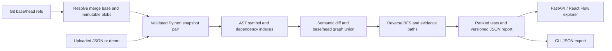

# Architecture

CodeImpact answers: **Which tests deserve attention after this Python change, and why?**
The starter is a stateless vertical slice. Its value lies in an explainable analysis
engine; the API and graph are ways to inspect the engine's evidence.



## Symbols and semantic comparison

Each node has an ID `repository/path.py::qualified.name`, source lines and a kind:
module, class, function or test. Tests are functions named `test_*` inside `test_*.py`
or `*_test.py` files, including class methods. This is a discovery heuristic, not
pytest collection. Parametrization and fixture injection are not modeled.

`ast.dump(..., include_attributes=False)` is SHA-256 hashed to compare semantics
without source locations. Comments, whitespace and moved lines do not count. A
function body, signature, decorator or annotation change can count. Modules include
the whole AST, so a function change also changes its module. Classes include methods;
nested functions also affect their enclosing function. This deliberately favors recall.

The collector recursively visits direct function/class bodies; definitions inside
conditional/loop/try blocks are not currently indexed. Duplicate module paths such
as `a.py` and `src/a.py` are rejected. Syntax failures are visible warnings and remain
as changed modules. Renames are represented as removal and addition.

## Graph semantics

Edges point **from dependent to dependency**:

- `call`: a supported lexical/imported call resolves to a known symbol.
- `import`: a module imports a known module.
- `module`: a symbol depends conservatively on its own module's initialization.

No runtime import takes place. Selected `import`, `from ... import`, aliases,
relative imports and a conventional leading `src/` directory are supported.
Parameters and local assignments that shadow a callable suppress that precise edge.
Re-exports, inherited methods, local imports, module-level rebinding, closures with
complex assignments and dynamic dispatch are incomplete. Even a resolved edge is a
static inference, not proof that a call executes.

Both revisions contribute nodes and edges. Removed functions stay visible and old
callers still propagate impact. A union path may combine edges from different
revisions, making the estimate intentionally conservative. Removed tests are never
recommended for execution in head.

## Impact and ranking

Multi-source reverse breadth-first search starts at changed nodes. A visited set
terminates cycles. Sorted inputs and adjacency lists make ordering deterministic.
One pass traverses all edges; another traverses only call edges from changed
non-module symbols. A call path is preferred when available; otherwise the report
labels the module/import fallback. The stored path runs **test → ... → changed node**.

The current priority formula is:

```text
clamp(1, 100,
      (90 for a call path, otherwise 50)
      - 10 × dependency distance
      + min(10, direct dependent count at the changed endpoint))
```

Scores sort descending with symbol ID as the tie-breaker. They are not trained or
calibrated failure probabilities. A directly modified test is explained separately.
The full test suite remains the correctness gate. A missing path means only that
this analyzer did not find one.

AST parsing/indexing is approximately linear in input size for simple cases. Two
graph traversals visit O(V+E) graph elements, but copying full evidence paths adds
O(V × path length) storage/work and can be quadratic on a long chain. Current sorting
and repeated nested AST walks add overhead. A later predecessor-map representation
can make traversal storage linear and materialize paths only for selected tests.
The CLI currently launches Git for each blob/size; batch object reads are a useful
measurable optimization once correctness is stable.

## Interfaces and UI

`GET /health`, `GET /api/demo`, `GET /api/demo/snapshots` and `POST /api/analyze`
are implemented. OpenAPI is at `/docs`. The 1.0 JSON report includes nodes, typed
edges/evidence, changed/removed/impacted IDs, recommendations, warnings and timings.

React Flow displays dependency arrows, search, module filtering, selection and
evidence highlighting. The dashboard uses real API results, including the demo.
Metrics include module nodes where labeled. Search filters the visible graph only;
it does not recompute recommendations. The UI exports a report; its upload expects
the separate snapshot-pair input schema.

No database, queue or credentials are required for this phase. Durable jobs, GitHub
ingestion, access control, caching and deployment should be separate modules when
introduced. A commit-SHA cache must also include analyzer version and settings in
its key; commit identity alone is insufficient when analysis behavior changes.

References: [Python AST](https://docs.python.org/3/library/ast.html),
[FastAPI testing](https://fastapi.tiangolo.com/tutorial/testing/),
[React Flow](https://reactflow.dev/learn), [Vite](https://vite.dev/guide/).
